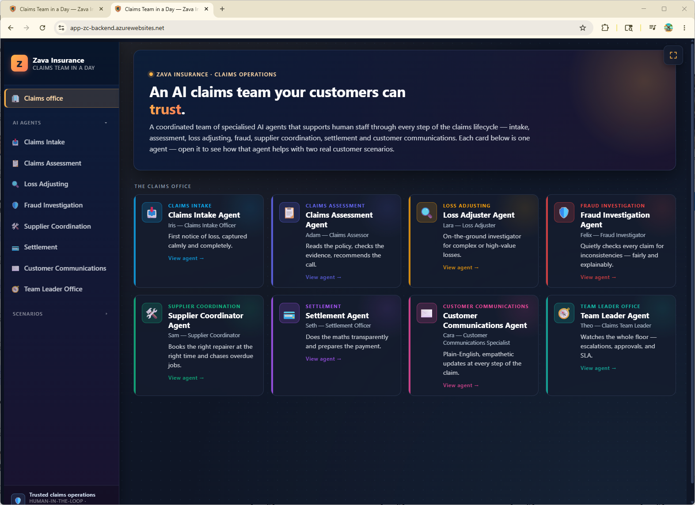
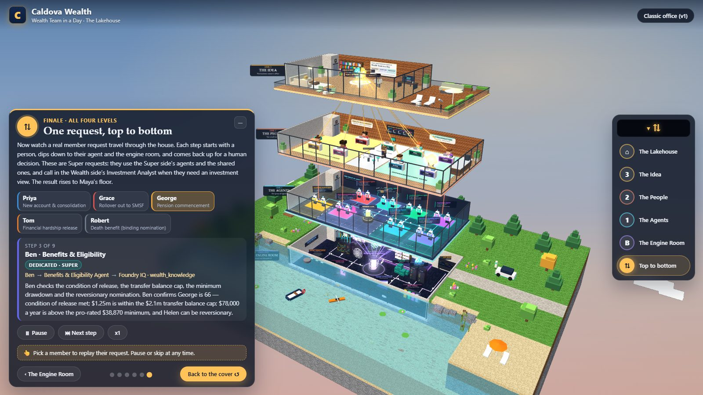

# Wealth Team in a Day

A demo for **Caldova Wealth**, a fictional super and wealth platform that is based in Melbourne and works mainly through financial advisers. It shows platform operations run by a coordinated team of specialised AI agents.

Inside **Caldova Client Operations**, each department has its own AI agent that supports a named human staff member through the full request lifecycle: **Request → Verify → Assess → Action → Confirm**. The departments are:

- onboarding and requests
- benefits and eligibility
- investment solutions
- financial crime
- transfers and rollovers
- payments
- client communications
- team leadership

See [AGENTS.md](AGENTS.md) for the demo overview, and the [docs/](docs/) folder for the industry background, characters, process, scenarios and the Lakehouse [storybook](docs/storybook.md) behind the frontend.

---

## The Wealth Operations Agent Team

Each agent owns one part of the request lifecycle, and all of them share a common **Member Case** record. Agents support human judgement; they don't replace it, and they never give personal financial advice.

Human approval is always required for:

- declines and partial approvals
- financial-crime blocks and suspicious matter reports (SMRs)
- a single payment of $250,000 or more, and every death benefit
- pension commencements of $1 million or more
- hardship releases
- complaint responses
- any communication to a fraud victim or a bereaved family

| # | Agent (staff name) | Staff role | What it does |
|---|---|---|---|
| 1 | **Onboarding Agent** (Olivia) | Onboarding & Requests Officer | Reads adviser emails and application forms, extracts every field, runs the NIGO (not in good order) checklist, then opens the Member Case and routes it. |
| 2 | **Benefits & Eligibility Agent** (Ben) | Benefits & Eligibility Assessor | Applies the PDS, trust deed and super law. It checks conditions of release, hardship criteria, the transfer balance cap, minimum pension payments, death benefit nominations and adviser fee consent. It cites each rule and recommends approve, partial or decline. |
| 3 | **Investment Analyst Agent** (Ivy) | Investment Analyst | Checks that the model portfolio fits the client's risk profile and Statement of Advice. It compares models on fees in dollars, builds pension income strategies, plans redemptions, and produces an Excel workbook with a chart. |
| 4 | **Financial Crime Agent** (Felix) | Financial Crime Investigator | Checks that ID documents are authentic and builds account-activity timelines. It screens for SMSF rollover red flags and politically exposed person (PEP) or sanctions matches, gives an explainable risk score, and recommends holds and call-backs. |
| 5 | **Transfers & Rollovers Agent** (Rory) | Transfers & Rollovers Coordinator | Moves money between Caldova and other funds, SMSFs and the ATO. It looks up funds by USI, warns before a rollover ends death or TPD cover, verifies SMSFs, generates transfer requests and tracks service levels. |
| 6 | **Payments Agent** (Penny) | Payments Officer | Validates payees, splits tax-free and taxable components, and calculates PAYG withholding. It checks authority limits, raises a Microsoft Teams approval card, and releases payment only after a human approves. |
| 7 | **Client Communications Agent** (Cara) | Client Communications Specialist | Drafts plain-English letters, adviser updates, SMS messages and call scripts in the right tone. It checks drafts for compliance, and Cara also has a voice agent that takes calls. |
| 8 | **Team Leader Agent** (Theo) | Client Operations Team Leader | Watches the whole floor: queues, service levels, complaint (IDR) clocks, approvals, quality and vulnerable members. It also runs a group chat that coordinates the other seven agents on one case. |

### How a request flows through the team

1. **Onboarding & Requests** captures the request, checks it's in good order and opens the Member Case.
2. **Benefits & Eligibility** checks the rules and recommends a decision, citing each rule.
3. **Investment Solutions** checks portfolio fit, shows fees in dollars, and plans income or redemptions.
4. **Financial Crime** runs when identity, documents or account activity need checking, and screens every new client.
5. **Transfers & Rollovers** moves money to and from other funds, SMSFs and the ATO.
6. **Payments** calculates components and tax, gets approval and releases the money.
7. **Client Communications** keeps the member and their adviser informed at every step.
8. **Team Leader Office** monitors the whole workflow, takes approvals and routes escalations.

For each agent's capabilities, inputs, tools, outputs and human-approval rules, see [docs/foundry_agents.md](docs/foundry_agents.md).

---

## Scenarios

All five scenarios use fictional people, practices and funds. The dates are in November 2026 (FY2026-27).

| # | Scenario | Member | Case | Outcome |
|---|---|---|---|---|
| 1 | [New client onboarding & super consolidation](docs/scenario-1-new-client-onboarding.md) | Priya Natarajan | `REQ-20261103-OPS001` | ✅ Completed: account opened, with the invalid nomination and the Death & TPD cover issue caught before any money moved |
| 2 | [Identity takeover & fake SMSF rollover blocked](docs/scenario-2-account-takeover.md) | Grace Williams | `REQ-20261106-OPS002` | 🛡️ Blocked: $612,400 protected |
| 3 | [Retirement: starting an account-based pension](docs/scenario-3-retirement-pension.md) | George Papadopoulos | `REQ-20261109-OPS003` | ✅ Completed: $1.25m pension started, approved in Teams |
| 4 | [Financial hardship early release](docs/scenario-4-financial-hardship.md) | Tom Bradley | `REQ-20261111-OPS004` | 🟡 Partially approved: $10,000 gross ($7,932 net), the legal maximum |
| 5 | [Death benefit under a binding nomination](docs/scenario-5-death-benefit.md) | Robert Chen | `REQ-20261113-OPS005` | ✅ Completed: benefit paid 50/50 to Robert and Lily |

For a presenter walkthrough and the 10-minute golden path, see [docs/agent-demo.md](docs/agent-demo.md).

---

## Built on Microsoft Foundry

Each staff role is a **Microsoft Foundry** agent. Every agent showcases at least one Foundry capability:

| Capability | How the demo uses it | Agents |
|---|---|---|
| **Declarative agents** (`Azure.AI.Projects`) | Each role is a Foundry agent created from code on a shared `CaldovaAgent` base class, with its own instructions and structured output. | All nine (eight staff agents plus Cara's voice agent) |
| **Azure AI Search grounding** | Answers are grounded in, and cite, the `wealth_knowledge` index: PDS and trust-deed extracts, super rules, the fee schedule, the model portfolio menu and the case files. | All. Benefits & Eligibility cites a rule for every check |
| **Bing grounding** | Public web grounding for up-to-date reference information. | All, through the shared base class |
| **MCP tools** (served by the backend at `/mcp`, server label `caldova-ops-mcp`) | **Investments:** analyse fact sheets, compare models, build the client workbook. **Transfers:** look up funds, verify SMSFs, generate the transfer request PDF. **Payments:** validate payees, calculate benefits, check authority limits, request approval and release payment. **Teams:** send the approval card. | Ivy, Rory, Penny |
| **Azure Content Understanding** | Checks the authenticity of ID documents, bank statements, SMSF letters and death certificates, and returns a legit, suspicious or fake verdict with the reasons. | Felix |
| **Microsoft Teams adaptive-card approvals** | Payments wait until a human approves the card in Teams. | Penny, with Theo approving |
| **Voice Live** | Talk to Cara by voice about a case. | Cara (voice agent) |
| **Multi-agent group chat** | Theo orchestrates the seven specialists on a single case. | Theo |

---

## Run It Locally

**Prerequisites**

- .NET 10 SDK
- Node.js 18 or later
- Azure CLI, signed in with `az login`. The agents authenticate with `DefaultAzureCredential`.
- A Microsoft Foundry project with:
  - a model deployment
  - an Azure AI Search connection to the `wealth_knowledge` index (see [ai-search/README.md](ai-search/README.md) to build it)
  - a Bing grounding connection

**Configuration.** Set these keys in `src/backend/appsettings.json` and `src/agent/appsettings.json`, or as environment variables:

- `AZURE_AI_PROJECT_ENDPOINT`
- `AZURE_AI_MODEL_DEPLOYMENT_NAME`
- `AZURE_TENANT_ID` (optional)
- `AZURE_AI_SEARCH_CONNECTION_ID`
- `AZURE_AI_SEARCH_INDEX_NAME`, set to `wealth_knowledge`
- `AZURE_BING_CONNECTION_ID`

The backend also uses `APP_MCP_URL`, the public base URL where Foundry reaches the backend's `/mcp` endpoint. When you run locally, point it at the deployed `app-caldovacs-backend` or at a dev tunnel.

**Backend** (Blazor agent console and APIs, at <http://localhost:5212>):

```powershell
dotnet run --project src/backend/cs-backend.csproj
```

**Frontend** (the voxel Lakehouse storybook, at <http://localhost:5173>):

```powershell
cd src/frontend
npm install
npm run dev
```

**Agent CLI** (run any agent from the command line):

```powershell
cd src/agent
dotnet run -- --onboarding "New Caldova Super (Select) application from Hannah Lewis at Yarra Private Wealth for Priya Natarajan. Please run the NIGO checklist."
```

The other flags are `--benefits`, `--investments`, `--fincrime`, `--transfers`, `--payments`, `--communications` and `--team-leader`.

To deploy to Azure (resource group `rg-caldova-super`), see `bicep/` and the GitHub Actions workflows in `.github/workflows/`.

---

## Screenshots

### Backend: agent operations console

The backend home page lists the eight agents in Caldova Client Operations. Each card opens the agent's live **Try it out** demo against the demo cases. Every run shows the agent's narrative, the references it cited, its prompt and tools, its input and its raw output.



### Frontend: the Lakehouse storybook

The frontend shows the same team as a voxel storybook you read from the top of a lakehouse to the bottom. Caldova is a wealth business for the agentic era, with two sides: Wealth Management and Superannuation.

- **Level 3** is business owner Maya Ashworth's office and her idea, "the brain", with one half for each side.
- **Level 2** holds two small teams: the Wealth Management Team and the Superannuation Team, with Theo leading both.
- **Level 1** has one group of Microsoft Foundry agents that supports both teams. Some agents are dedicated to a side and some are shared by both. Each agent and each of its specialised assistants is its own robot: 25 roles in all.
- **The engine room**, under the waterline, holds Microsoft IQ (Work IQ, Fabric IQ, Foundry IQ and Web IQ) on a raised deck, with the Azure services around it.

People and agents move about their floors as they work. Out front, members and clients arrive by water taxi and sign at the front desk on the dock. Up on the roof, Caldova throws a party for them under a big CALDOVA WEALTH sign. Each chapter opens up one level. The finale starts at the dock, then pulls the house apart to trace a member request from top to bottom. See [docs/storybook.md](docs/storybook.md).



---

## Contributing

Contributions are very welcome! You could add or refine an agent, sharpen a scenario, polish the voxel lakehouse, or fix a typo.

Ways to contribute:

- **Open an issue** to report a bug, suggest an enhancement, or propose a new member request scenario.
- **Submit a pull request** with code, content or documentation changes. Small PRs are perfect.
- **Share ideas** for new agents, client personas or operations workflows that fit the Caldova Wealth story.
- **Improve the docs** in the [docs/](docs/) folder: background, characters, process, scenarios and visual themes.

Keep contributions aligned with these principles:

- Keep the operations-office metaphor and the guidance in [AGENTS.md](AGENTS.md).
- Agents support people and never give personal financial advice.
- Rules and numbers must be real, current and cited.
- People, practices and funds stay fictional.

Be kind, be constructive, and have fun building the wealth team.
