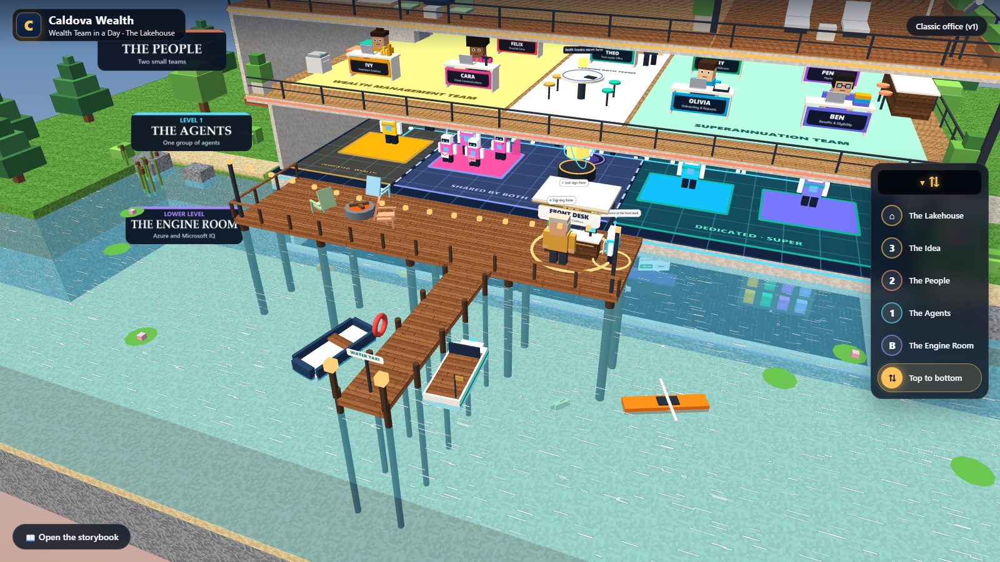
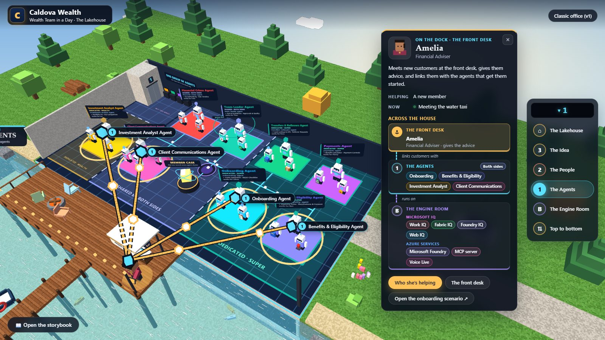
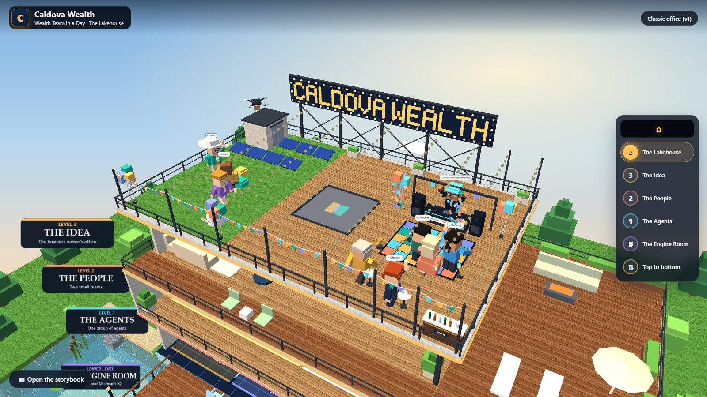
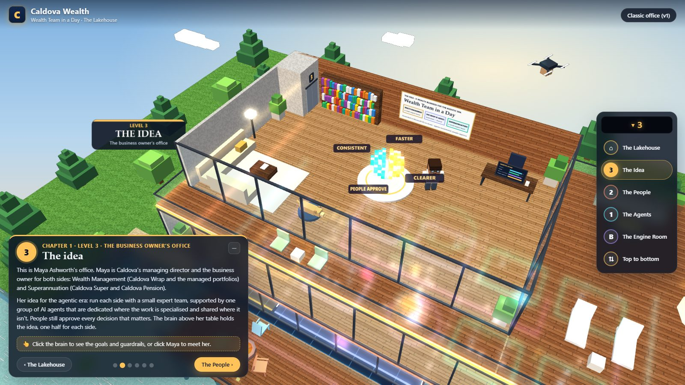
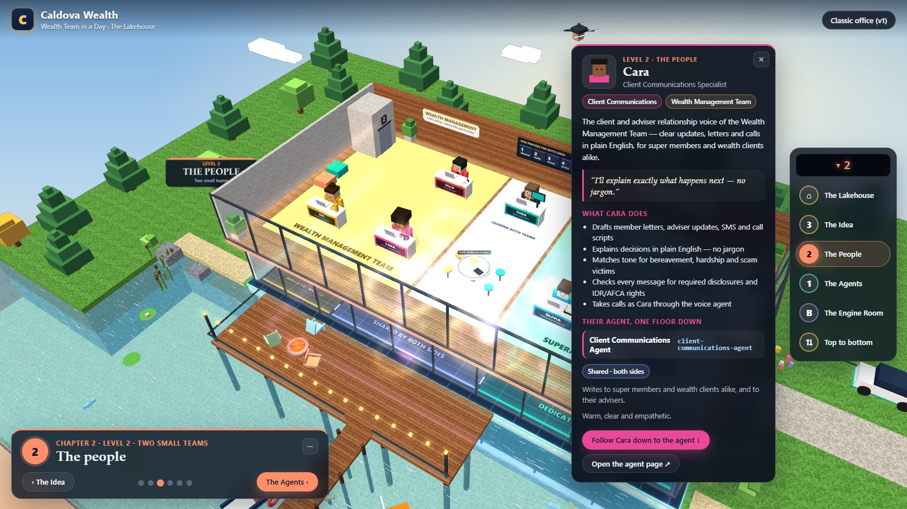
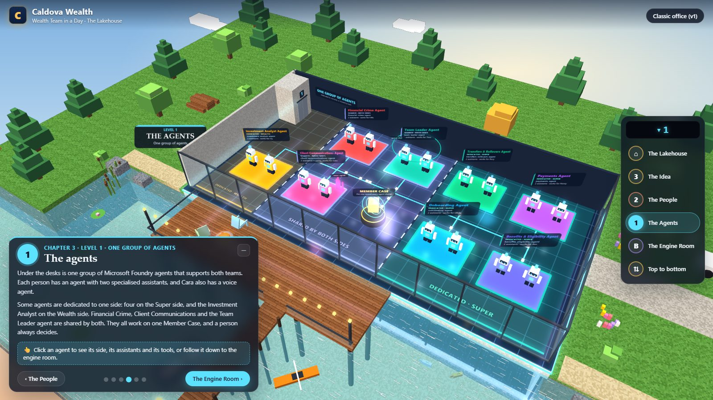
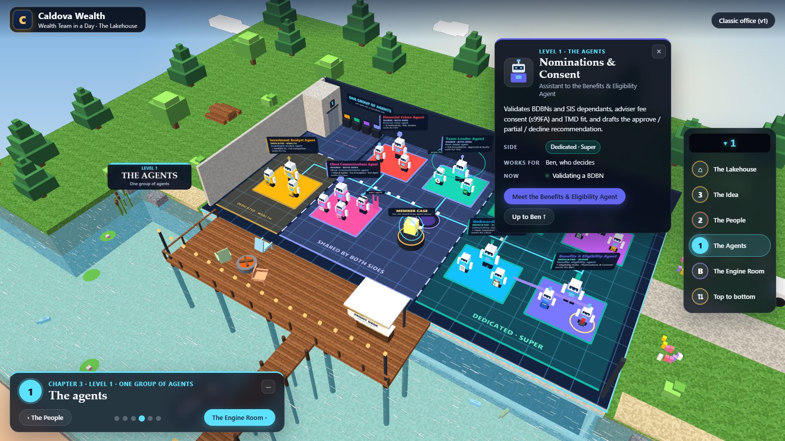
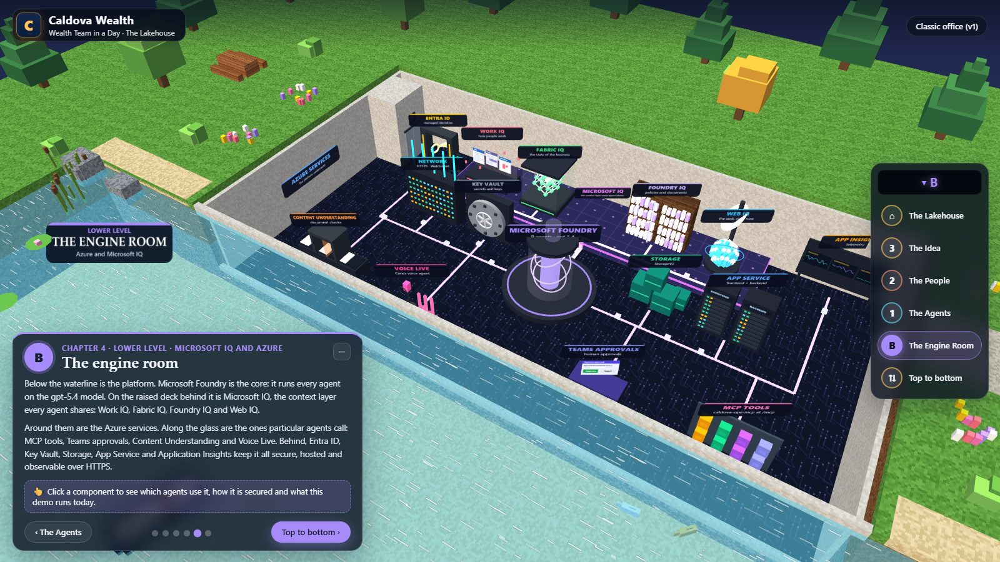
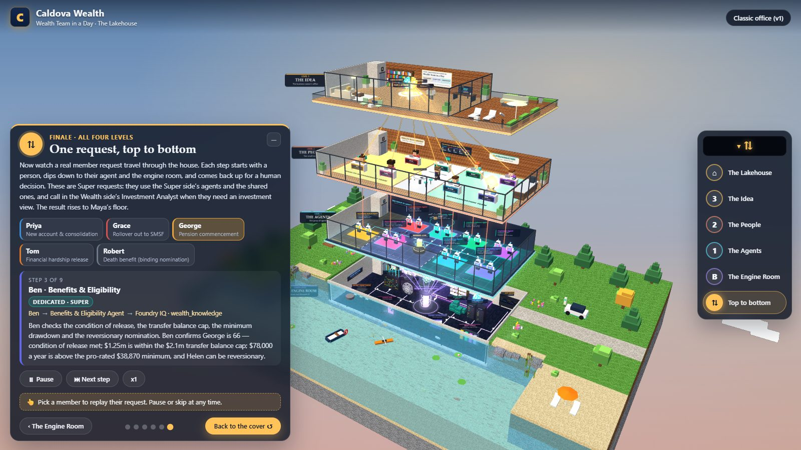

# Storybook — The Lakehouse

> Part of **Wealth Team in a Day** — the AI operations office demo for **Caldova Wealth**.

The frontend, served at **`/`**, tells the Wealth Team in a Day story as a storybook. Caldova Wealth is a wealth management business built for the agentic era. It has **two sides**, Wealth Management and Superannuation, with a **small team for each side** and **one group of AI agents** that supports both. Viewers read the story from the top of a house to the bottom: the business owner's idea, the two teams, the agents, and the Microsoft IQ and Azure services underneath.

This document is the source of truth for the frontend: the setting, the cast, every page and how each page behaves. The page text in [`src/frontend/src/v2/storyData.ts`](../src/frontend/src/v2/storyData.ts) mirrors it, so change both together.


---

## The Big Idea

**One business, two sides, four levels, read from the top down.**

| Level | Name | Who or what is there | The question it answers |
|---|---|---|---|
| **3** | **The Idea** | Maya Ashworth, the business owner for both sides, and her idea: "the brain" | Why are we doing this, and what are the rules? |
| **2** | **The People** | Two small teams, one for each side, with Theo leading both | Who makes the decisions? |
| **1** | **The Agents** | One group of Microsoft Foundry agents: some dedicated to a side, some shared by both | Who does the reading, checking, calculating and drafting? |
| **B** | **The Engine Room** | Microsoft IQ and the Azure services, under the waterline | Where does the context come from, and what keeps it all running? |

Each level hangs off the one above it:

- The idea sets the goals and guardrails for both sides.
- People own the decisions, in two small teams.
- Each person's agent sits directly underneath them and reports back to them. The agents form one group: dedicated where the work is specialised, shared where it isn't.
- Microsoft IQ gives every agent the same context, and the Azure services power them all.

A thread runs through the whole house: **idea → person → agent → Microsoft IQ and Azure**. Whatever the viewer clicks, they can follow that thread up or down.

Both sides follow one request lifecycle, **Request → Verify → Assess → Action → Confirm**, shown on the process board on Level 2. The finale traces one request through it, from the front desk to the result.

### The Two Sides

| Side | Products | Team | Dedicated agents |
|---|---|---|---|
| **Wealth Management** (gold `#c9a14a`) | Caldova Wrap · Caldova Managed Portfolios | Wealth Management Team: Ivy, Cara and Felix | Investment Analyst Agent |
| **Superannuation** (teal `#14b8a6`) | Caldova Super · Caldova Pension | Superannuation Team: Olivia, Ben, Rory and Penny | Onboarding, Benefits & Eligibility, Transfers & Rollovers, and Payments agents |
| **Shared by both** (lilac `#8b9cf7`) | Caldova Cash Account | Theo leads both teams | Financial Crime, Client Communications and Team Leader agents |

Cara and Felix sit with the Wealth Management Team. Their work, communications and financial crime, spans both sides, so their agents are **shared**. The Super side has the most specialised processes (super law, rollovers and benefit payments), so it has the most dedicated agents. When a Super request needs an investment view, the Super team **calls in** the Wealth side's Investment Analyst.

---

## The Setting: A Futuristic Lakehouse

Caldova Wealth works from a casual, futuristic lakehouse on the edge of Melbourne. The whole scene is a floating voxel diorama, with an island of grass, earth and stone layers and a lake carved into its front.

- **The house:** three storeys of timber, steel and white concrete, stacked with deep cantilevers.
  - There is no glass facade. The floors are open to the lake and the right-hand side, with slim steel rails along the edges, so every level reads clearly from outside.
  - The back walls are cedar slats, and the left wall holds a concrete lift core with a floor number lit above the lift doors on every level.
- **Two sides, left and right:** on every floor the Wealth Management side is on the left, the Superannuation side is on the right, and what both sides share is in the middle.
- **Edge lights:** each floor slab has a glowing edge strip in that level's accent colour: gold for the idea, coral for the people, cyan for the agents and violet for the engine room.
- **The roof:** a party deck for Caldova's customers under a big glowing CALDOVA WEALTH sign (see [The Roof](#the-roof-a-party-for-the-customers)), beside a green roof with solar panels and the lift up from below, and a skylight over the brain.
- **Outside:**
  - A cedar deck on stilts over the water, with a fire pit, chairs, string lights and a timber rail.
  - **The front desk** on the deck, under a white canopy, where visitors sign in and Amelia, Caldova's financial adviser, gets them started (see [The Dock](#the-dock-and-the-front-desk)).
  - A jetty with lanterns, a rowboat, a kayak and a WATER TAXI stop.
  - Pines and autumn trees, and a sandy beach with an umbrella.
  - A gravel driveway with an EV at its charger, and a delivery drone circling the roof.
- **Under the waterline:** the engine room is sunk into the island behind a glass wall onto the lake, so fish swim past the servers.
- **Sky:** a golden-hour gradient. It dims to dusk when the story goes down to the engine room.

```
             ┌───── roof · CALDOVA WEALTH sign · the party · green roof ─────┐
  LEVEL 3    │  THE IDEA    Maya's office · the brain (one half for each side) │  terrace
             ├───────────────────────────────────────────────────────────────┤
  LEVEL 2    │  WEALTH MANAGEMENT TEAM  │ Theo │  SUPERANNUATION TEAM         │
             │  Ivy · Cara · Felix      │ lead │  Olivia · Ben · Rory · Penny │
             ├───────────────────────────────────────────────────────────────┤
  LEVEL 1    │  DEDICATED · WEALTH │ SHARED BY BOTH SIDES │ DEDICATED · SUPER │ deck · front desk ═══ jetty · water taxi
 ~~~~~~~~~~~~│~~~~~~~~~~~~~~~~~~~~~~~~~ waterline ~~~~~~~~~~~~~~~~~~~~~~~~~~~│~~~~~~~~~~~~
  LOWER      │  MICROSOFT IQ deck: Work IQ · Fabric IQ · Foundry IQ · Web IQ   │  lake
  LEVEL      │  Microsoft Foundry at the core · Azure services all around    │
             └───────────────────── glass wall onto the lake ────────────────┘
```

---

## The Cast

### Maya Ashworth — Managing Director, Caldova Wealth (Business Owner)

Maya is the business owner for **both sides** of Caldova: Wealth Management and Superannuation. She sets the goals, decides where to invest, and holds the line on one rule: **people approve every decision that matters**. Like the staff, her name follows the role keyword: **M**aya, **M**anaging director. Her full profile is in [characters.md](characters.md#maya-ashworth--managing-director-business-owner).

- **Personality:** curious, practical and people-first.
- **Typical line:** "If a member has to chase us, we've already let them down."
- **Look:** smart-casual for the lakehouse: a cream knit, slate trousers, a Caldova-gold scarf, glasses and long dark hair.
- **In her office** she moves between the vision board, the bookshelf, the North Star dashboard on her desk, Biscuit's bed and the terrace telescope, where she watches the water taxi come in.

**The idea** carries the product message, held in the brain above her table:

> Run both sides of Caldova with small expert teams supported by one group of AI agents: dedicated where the work is specialised, shared where it isn't, and all grounded in the same IQ layer on Azure. Requests become clearer, faster and more consistent, and people approve every decision that matters.

| Goal | What it means |
|---|---|
| **Clearer** | Members, clients and advisers always know where their request is and what happens next. |
| **Faster** | Agents do the reading, checking, calculating and drafting in minutes, so requests don't sit in a queue. |
| **More consistent** | Both sides follow one lifecycle, and every check cites the rule it relied on. |
| **People approve** | Agents recommend. A named person makes every decision that matters. |

**The guardrails** are the human approvals listed in the [README](../README.md#the-wealth-operations-agent-team):

- declines and partial approvals
- financial-crime blocks and SMRs
- payments of $250,000 or more, and every death benefit
- pension commencements of $1 million or more
- hardship releases
- complaint responses
- any communication to a fraud victim or a bereaved family

Agents never give personal financial advice.

### Amelia — Financial Adviser, the Front Desk

Amelia is Caldova's own financial adviser, and she works out front at the front desk on the dock. Like the staff, her name follows the role keyword: **A**melia, **A**dviser. She gives the advice, which agents never do, then links each new customer with the agents that get them started (see [The Dock](#the-dock-and-the-front-desk)). Her full profile is in [characters.md](characters.md#amelia--financial-adviser-front-desk).

- **Personality:** warm, unhurried and clear.
- **Typical line:** "Hi Priya! Hannah sent your pack ahead."
- **Look:** a burgundy blazer with a Caldova-gold badge, charcoal trousers and a dark ponytail. She holds a tablet that lights up in the colour of the agent she is linking.
- **Between visitors** she reviews Statements of Advice, prepares welcome packs, checks fee consent forms and reads model portfolio fact sheets.

| She links customers with | What it does to get them started |
|---|---|
| Olivia's Onboarding Agent | Opens the account and checks the forms are in good order |
| Ben's Benefits & Eligibility Agent | Checks eligibility, insurance cover and fee consent |
| Ivy's Investment Analyst Agent | Checks portfolio fit and shows the fees in dollars |
| Cara's Client Communications Agent | Sends the welcome pack and keeps everyone updated |

### The People (Level 2)

The eight staff work at standing desks, arranged as two wings with Theo between them (see [characters.md](characters.md)):

- **Left wing, the Wealth Management Team** on a gold rug: Ivy (Investment Solutions), Cara (Client Communications) and Felix (Financial Crime).
- **In the middle,** Theo leads both teams from a desk on a lilac rug, with a huddle table in front where both teams meet.
- **Right wing, the Superannuation Team** on a teal rug: Olivia (Onboarding & Requests), Ben (Benefits & Eligibility), Rory (Transfers & Rollovers) and Penny (Payments).

Nobody is stuck at a desk. Each person heads off on errands as they work and then comes back: a coffee, the printer, the huddle table, the process board, their wing's board, a look at the lake, or a quick question at a colleague's desk (only if the colleague is there). A speech bubble says what they are doing, and their card shows it too.

### The Agents (Level 1)

Each person's **Microsoft Foundry agent** has a bay directly under their desk. The agent and each of its two specialised assistants (named in `agentStages.ts` and [foundry_agents.md](foundry_agents.md)) is its own voxel robot, so the floor has **25 roles**: 8 agents, 16 assistants and Cara's voice agent.

- **The agent** is the big robot, with a glowing sash in its side's colour.
- **Each assistant** carries a prop for its job: Form Extraction a document, NIGO Checklist a clipboard, Eligibility Rules a rule book, Nominations & Consent a stamp, Portfolio Fit a pie chart, Fee Comparison a bar chart, ID Authenticity a magnifier, Risk Timeline a timeline, Fund Lookup & SVS a globe, Rollover Requests a parcel, Benefit Calculator a calculator, Payment Controls a padlock, Letters & Updates an envelope, Tone & Compliance a heart, SLA & Escalations a clock and Approvals & Quality a badge. The voice agent wears a headset.

The floor is one group of agents in three zones, and each bay's frame glows in the colour of its side.

| Zone | Person | Foundry agent | What makes it different |
|---|---|---|---|
| Dedicated · Wealth | Ivy | `investment-analyst-agent` | MCP tools: analyse fact sheets, compare models, build the client workbook. The Super team calls it in for an investment view. |
| Shared by both | Cara | `client-communications-agent`, plus `client-communications-voice-agent` | Writes to super members and wealth clients alike, and has a voice agent on Azure Voice Live |
| Shared by both | Felix | `financial-crime-agent` | Azure Content Understanding checks documents for tampering, on both sides |
| Shared by both | Theo | `team-leader-agent` | Runs the group chat that coordinates the other seven agents on one case |
| Dedicated · Super | Olivia | `onboarding-agent` | Runs the NIGO checklist against the guides in Foundry IQ |
| Dedicated · Super | Ben | `benefits-eligibility-agent` | Cites a rule from Foundry IQ for every check |
| Dedicated · Super | Rory | `transfers-rollovers-agent` | MCP tools: look up funds, verify SMSFs, generate the transfer request PDF |
| Dedicated · Super | Penny | `payments-agent` | MCP tools for benefits and limits, then a Microsoft Teams approval |

All eight run on Microsoft Foundry and share the Microsoft IQ layer through the `CaldovaAgent` base class. At the front of the shared zone is the **Member Case**: the one record every agent reads from and writes to, wired to every bay.

**The roles move about the floor as they work**, then go back to their bays. A speech bubble says what each one is doing:

- to the **Member Case** hub, to read and update the case
- to the **Foundry uplink** in the middle of the floor, where a beam rises to the engine room while they call the model
- to the **MCP tool bench** at the back, for the roles whose agents use MCP tools (Ivy's, Rory's and Penny's)
- to the bay they hand work to, following the [handoff rules](foundry_agents.md#suggested-agent-handoff-rules): Onboarding hands to Benefits & Eligibility or Financial Crime; Benefits & Eligibility to Financial Crime, the Investment Analyst or Transfers & Rollovers; the Investment Analyst and Transfers & Rollovers to Payments; and Payments to Client Communications. Any agent can escalate to Theo's, and Theo's agent coordinates the rest.
- out to the lakeside, to watch the boats

Olivia's **Form Extraction** assistant also works the front desk on the dock: it walks out whenever a visitor is on the way, and reads the form they sign.

### The Engine Room (Lower Level)

The engine room has two tiers. Each component is a voxel machine with a sign, wired to Microsoft Foundry by floor traces that carry pulses of data. The details come from `bicep/` and the backend code.

**Microsoft IQ, the context layer every agent shares**, stands on a raised deck behind Foundry, wired to the core by its own fuchsia traces. Microsoft IQ brings together Work IQ, Fabric IQ and Foundry IQ, plus Web IQ for the web. Each card says honestly how the scenarios use it today, under "In the scenarios".

| Sign | Gives agents | In the scenarios |
|---|---|---|
| WORK IQ | How people work: the documents, conversations, meetings and past decisions in Microsoft 365, permission-trimmed | Not wired up yet. Adviser emails arrive as case documents, and approvals go to Microsoft Teams through an MCP tool. |
| FABRIC IQ | The state of the business: governed data, business entities, relationships and rules across both sides, built on Microsoft Fabric | Not wired up yet. The backend's Member Case store and the case files stand in for it. |
| FOUNDRY IQ | Policies and documents: the PDS and trust-deed extracts, super rules, fee schedule, model portfolio menu and case files, returned with citations | Live. Azure AI Search is now Foundry IQ, and every agent grounds on and cites the `wealth_knowledge` index (semantic search enabled). |
| WEB IQ | The web, right now: timely, citation-ready context from the public web | Stood in for by the Grounding with Bing Search connection in the Foundry project. |

**The Azure services** fill the rest of the room. Along the glass are the ones particular agents call, and behind the bus is the platform.

| Sign | Component | What it does | Used by |
|---|---|---|---|
| MICROSOFT FOUNDRY | Agent platform and model | Hosts the nine agents and the `gpt-5.4` deployment (GlobalStandard, default content filters) | Every agent |
| MCP TOOLS | `caldova-ops-mcp` at `/mcp` | Tools that let agents act on systems | Ivy (Wealth), Rory and Penny (Super) |
| TEAMS APPROVALS | Microsoft Teams adaptive cards | A payment waits for a human approval (sent by `teams_sendApprovalCard`; delivery is simulated in the scenarios) | Penny, approved by Theo |
| CONTENT UNDERSTANDING | Azure Content Understanding | Legit, suspicious or fake verdicts on documents | Felix (shared) |
| VOICE LIVE | Azure Voice Live | Talk to Cara's voice agent; the backend proxies the WebSocket | Cara (shared) |
| ENTRA ID | Managed identities and RBAC | No keys in code; roles scope each identity. Its gate stands beside the lift. | Platform |
| NETWORK | How it all connects | HTTPS everywhere plus a WebSocket for Voice Live, over public endpoints secured by Entra ID; production would add private endpoints | Platform |
| KEY VAULT | Azure Key Vault | Provisioned for secrets and keys | Platform |
| STORAGE | StorageV2 account | Provisioned for documents and generated files | Platform |
| APP SERVICE | Two Linux web apps | The frontend (Node 20) and the backend (.NET 10: agent console, APIs, Member Case store, MCP endpoint) | Platform |
| APP INSIGHTS | Application Insights and Log Analytics | Telemetry from both web apps | Platform |

### The Dock and the Front Desk



Out front, the house meets the people it serves. Members, clients and advisers arrive by **water taxi**, a small electric boat that pulls in at the WATER TAXI stop at the end of the jetty. They walk up the jetty to **the front desk** on the deck ("FRONT DESK · Welcome to Caldova"), where **the greeter** welcomes them, **Amelia**, Caldova's financial adviser, gets them started, and they sign their application, policy or death benefit claim.

1. The water taxi sails in, the greeter calls "Welcome to Caldova!", and the visitor steps onto the jetty.
2. Olivia's **Form Extraction** agent walks out from its bay to the desk, and Amelia welcomes the visitor as they walk up.
3. The visitor signs. Then Amelia links them with the agents that get them started, one at a time: her tablet lights up in each agent's colour, a gold beam runs from her to the agent's bay on Level 1, and the bay lights up.
4. The form gets a SIGNED stamp, the agent scans it, and a note reads "Signed · sent to Onboarding": the form becomes a new Member Case.
5. The visitor walks back to the water taxi and sails home, and Amelia's beams fade.

| Who comes by | Side | Signs | Amelia links them with |
|---|---|---|---|
| Four of the five finale members: Priya, George, Tom and Robert | Superannuation | Their application or death benefit claim (see the [finale](#finale--one-request-top-to-bottom)) | The Onboarding Agent |
| For the fifth, someone hooded, in dark glasses, signing in Grace's name | Superannuation | A rollover request for Grace's account, while Grace is in Italy | The Onboarding Agent. Felix's Financial Crime Agent checks the request later. |
| A new member | Superannuation | Caldova Super, and the policy for her insurance cover | The Onboarding and Benefits & Eligibility agents |
| A new client | Wealth Management | A Caldova Wrap account application, set up with his adviser | The Onboarding and Investment Analyst agents |
| An adviser | Wealth Management | A Managed Portfolio application for a client | The Onboarding, Investment Analyst and Client Communications agents |

Amelia's words are kind and plain, especially for Tom's hardship and Robert's loss: "Hi Tom. We'll help you through this." Her beams show while the dock and the agents are in view (the cover, Chapter 3 and the finale's arrival), and give way to anything else the viewer has clicked.



Whenever the finale isn't playing, the everyday visitors keep coming, one water taxi at a time.

> **In the scenarios**, requests arrive as adviser emails, forms and member requests. The dock is the storybook's way of showing them coming in.

### The Roof: a Party for the Customers



Up on the roof, Caldova Wealth throws a party for the people the whole house works for: its members, clients and their advisers. It is the first thing viewers see on the cover, before the story goes down through the house.

- **The sign:** CALDOVA WEALTH in big glowing gold voxel letters on a navy board along the back of the roof, framed by chasing marquee bulbs on a steel frame. Fireworks go up behind it every so often.
- **The party deck:** timber decking with string lights from the front posts up to the sign, and bunting in the party colours (the two sides' gold and teal, the shared lilac, and the levels' coral and cyan).
  - **The DJ booth**, with turntables, speakers that kick on the beat, a lighting truss and a banner: "Celebrating our members, clients and advisers".
  - **The dance floor**, with tiles that change colour on the beat and a confetti cannon at each front corner.
  - **The bar**, two cocktail tables and balloons.
- **The green roof:** George's retirement cake ("Happy retirement, George!"), a lounge of beanbags, the solar panels and the lift that brings the guests up.
- **The skylight** looks down on the brain glowing in Maya's office.

| Guest | Who they are |
|---|---|
| George and Helen | George has just retired, and his Caldova Pension now pays him every month. Helen is his reversionary beneficiary. |
| Priya | New to Caldova Super, with her old super brought across into one account |
| Marcus Tan and Hannah Lewis | The advisers, Bayside Financial Partners and Yarra Private Wealth, here with their clients |
| A Caldova Wrap client, a Managed Portfolios client and a Caldova Super member | Members and clients from both sides |

The guests come and go like everyone else in the house. They dance, get a drink at the bar, try the cake, take in the view and peek down at the brain, and always come back to their table or the lounge. A speech bubble says what each is doing. Every so often the DJ calls a toast ("A toast to George's retirement!"): glasses go up, everyone says "Cheers!", and the confetti cannons fire.

The guests are the customers with happy news. The finale's other requests (a hardship release, a scam and a death benefit) are not party stories, so Grace, Tom and Robert are not on the roof. When the finale plays George's or Priya's request, they leave the party and go down to the dock to sign.

- **Interaction:** Click the sign, the dance floor, the DJ booth, the bar, the cake or the lounge for the party's card: what it is, who is there and what is happening now. "Take a closer look" flies the camera to the roof. Click a guest for their card. George's and Priya's cards end with "Watch his request ›" or "Watch her request ›", which replays it in the finale.

---

## How to Read the Storybook

The storybook has a cover, four chapters (one per level) and a finale. Each chapter opens up its level: the levels above lift away and fade out, so the camera can look straight in.

| Control | What it does |
|---|---|
| **Begin the story ›** on the cover | Opens Chapter 1 |
| **Next › / ‹ Back**, the page dots, or the **arrow keys** | Turn the page; down and right go deeper |
| **The lift** on the right (⌂, 3, 2, 1, B, ⇅) | Jumps to any level; the display shows the floor and the direction of travel |
| **The arrows** at the bottom right (‹ ›) | Slide the view left or right, for example to see past a card. A press moves a step, and holding keeps it moving, as far as the edge of the house and dock. Turning the page, or pressing the current floor in the lift, brings the view back |
| **Click** a person, the brain, an agent or one of its assistants, a machine, the front desk, Amelia or a visitor | Opens its card, lights it up and draws its beams through the house |
| **Card actions** such as "Follow Cara down to the agent ↓", or any name in a card's **Across the house** | Move along the thread to the level below or above |
| **A beam's label** in the house, such as "B · Microsoft IQ" | Goes to that end of the beam |
| **Esc**, or clicking empty space | Closes the card |
| **–** on the page card | Hides the storybook so the viewer can explore freely; **📖 Open the storybook** brings it back |
| **Drag / scroll** | Orbit and zoom at any time |
| **Home / End** | Cover / finale |

Every page has a deep link, for example `/?page=people`. The address bar updates as the viewer turns pages.

---

## The Pages

### Cover — One Business, Two Sides, Four Levels


- **Scene:** The whole lakehouse at golden hour, with the camera slowly circling until the viewer touches it. The level tags float beside the house, the open floors show the gold and teal wings, a water taxi brings a visitor to the front desk on the dock, and the customers' party is in full swing on the roof under the CALDOVA WEALTH sign.
- **Narration:** "Caldova Wealth is a wealth management business built for the agentic era. It has two sides, Wealth Management and Superannuation, and runs both from a lakehouse on the edge of Melbourne. Read it from the top down: the owner's idea, two small teams, one group of AI agents that supports both and, under the waterline, Microsoft IQ and the Azure services that power it all. Out front, members and clients arrive by water taxi and sign in at the front desk on the dock, where Amelia, Caldova's financial adviser, gets them started. Up on the roof, Caldova throws a party for them."
- **Interaction:** "Begin the story ›" or "Explore freely". The cover lists the four levels with their colours.

### Chapter 1 — Level 3 · The Idea



- **Scene:** The roof lifts off Maya's office.
  - Maya stands by a round white table. Above it floats a voxel brain with **one hemisphere for each side**: gold for Wealth Management and teal for Superannuation, joined by a lilac bridge for what they share. Four goal tiles orbit it: CLEARER, FASTER, CONSISTENT, PEOPLE APPROVE.
  - On the back wall is a vision board: "The idea · a wealth business for the agentic era · Wealth Team in a Day", with three panels (Wealth Management, One group of agents, Superannuation) and "Grounded in Microsoft IQ on Azure · agents recommend, people approve". There is also a bookshelf, and Maya's desk has a North Star dashboard.
  - In the lounge corner are a sofa and a floor lamp, and Biscuit the office dog is asleep on her bed.
  - Outside are the balcony and a terrace with loungers, an umbrella, a fire table and a telescope pointed at the lake. Maya moves about her office as she works, and stops at the telescope to watch the water taxi come in.
- **Narration:** "This is Maya Ashworth's office. Maya is Caldova's managing director and the business owner for both sides: Wealth Management (Caldova Wrap and the managed portfolios) and Superannuation (Caldova Super and Caldova Pension). Her idea for the agentic era: run each side with a small expert team, supported by one group of AI agents that are dedicated where the work is specialised and shared where it isn't. People still approve every decision that matters. The brain above her table holds the idea, one half for each side."
- **Interaction:**
  - **The brain:** its card shows the idea, the two sides with their products and teams, the one group of agents, the four goals, the lifecycle and the guardrails. Gold beams drop from the brain to every person on Level 2, each labelled with their name.
  - **Maya:** her card: her role, the goals she sets and what she is doing now, then **Across the house** (see [Following a Thread](#following-a-thread)): her office at the top, both teams, the one group of agents by side, and everything they run on in the engine room.
- **Intro beat:** the brain lights up and spins faster.

### Chapter 2 — Level 2 · The People


- **Scene:** Level 3 lifts away to reveal the open-plan team floor, split into two wings.
  - **Left wing:** the Wealth Management Team on a gold rug, under a WEALTH MANAGEMENT sign (Caldova Wrap · Caldova Managed Portfolios).
  - **Right wing:** the Superannuation Team on a teal rug, under a SUPERANNUATION sign (Caldova Super · Caldova Pension).
  - **In the middle:** Theo ("leading both teams") on a lilac rug, below the ONE PROCESS FOR BOTH SIDES board. In front of him is the huddle table, with gold stools on the wealth side and teal stools on the super side ("both teams meet here").
  - Every standing desk has a name panel in the department colour and a prop that says something about the role: Ivy's bar chart, Cara's headset, Felix's magnifier, Theo's dashboard, Olivia's inbox tray, Ben's rule books, Rory's globe and Penny's calculator.
  - There is a coffee bar on the right, a printer by the left wall and beanbags by the lift.
  - People come and go from their desks as they work: Penny grabs a flat white, Olivia collects printouts, Ben talks a case through at the huddle table, and Theo drops by Cara's desk with a quick question. A speech bubble says what each is doing.
- **Narration:** "One floor down, the idea becomes two small teams. On the left, the Wealth Management Team: Ivy runs the model portfolios, while Cara and Felix handle client communications and financial crime for both sides. On the right, the Superannuation Team: Olivia, Ben, Rory and Penny. Theo sits between them and leads both teams. People talk to members, clients and advisers, weigh the evidence and make the calls, and both sides follow one lifecycle: Request, Verify, Assess, Action, Confirm. Nobody is stuck at a desk: they meet at the huddle table, check the process board and drop by each other's desks."
- **Interaction:** Click a person to open their card. A gold ring appears at their feet. The card is kept short:
  - their role in one line, as in [characters.md](characters.md)
  - **Now:** what they are doing right now, which updates while the card is open
  - **Across the house:** the person, their agent one floor down with its side (dedicated to one side or shared by both) and its assistants, and what it runs on in the engine room (see [Following a Thread](#following-a-thread))

  "Follow {name} down to the agent ↓" opens Chapter 3 with that agent selected. "Open the agent page ↗" opens the backend's `/agents/{id}` walkthrough.
- **Intro beat:** "The idea drops in": gold sparks fall from where the brain sits above and land on each desk, and each person lights up as their spark arrives.



### Chapter 3 — Level 1 · The Agents



- **Scene:** Level 2 lifts away to reveal a dark floor with a glowing grid, split into three tinted zones by dashed lines and lettered at the front: DEDICATED · WEALTH (gold), SHARED BY BOTH SIDES (lilac) and DEDICATED · SUPER (teal).
  - Under every desk is a coloured bay for that person's agent and its two assistants, each a voxel robot. The bay's frame glows in its side's colour.
  - Each bay has a holo panel showing the agent's name, its side, its Foundry agent id, its two assistants and "works for {name}".
  - The **Member Case** hub glows at the front of the shared zone, wired to every bay by circuit traces that carry data packets out and back.
  - Behind the hub is the **Foundry uplink**, a violet ring that beams up whenever a robot is calling the model. At the back, by the lift, is the **MCP tool bench** with four coloured terminals.
  - Theo's bay has a floating **group chat** ring, and Cara's has a **voice agent** equaliser.
  - The back wall by the lift reads "ONE GROUP OF AGENTS · Each agent with its specialised roles".
  - The robots come and go from their bays as they work (see [The Agents](#the-agents-level-1)), each with a speech bubble saying what it is doing.
  - When Amelia links a visitor at the front desk with an agent, a gold beam runs from her to its bay and the bay lights up.
- **Narration:** "Under the desks is one group of Microsoft Foundry agents that supports both teams. Each person has an agent, and each agent has two specialised assistants: 25 roles in all, counting Cara's voice agent. They move about as they work, between their bays, the Member Case hub, the Foundry uplink and the MCP tool bench. Some agents are dedicated to one side: four on the Super side, and the Investment Analyst on the Wealth side. Financial Crime, Client Communications and the Team Leader agent are shared by both. They hand work to each other on one Member Case, and a person always decides."
- **Interaction:** Click a robot or its bay to open its card. Cards are kept short:
  - **An agent** (the big robot, or its bay): what it does in one line, who it hands off to and what it is doing now, then **Across the house**: its person above, its side and assistants, and what it runs on in the engine room. Beams drop to those components. "Back up to {name} ↑" or "What powers it ↓".
  - **An assistant or the voice agent:** what it does in one line and what it is doing now, then the same **Across the house**, with this assistant marked. The Form Extraction card adds that it reads every signed form at the front desk. "Meet the {agent}" or "Up to {name} ↑".
  - **Open the agent page ↗**, under the name on all of these cards, opens the agent's own page in the backend agent console in a new tab. An assistant's or the voice agent's card opens the page of the agent it works for.

  
- **Intro beat:** the bays power up one after another.

### Chapter 4 — Lower Level · The Engine Room



- **Scene:** Level 1 lifts away and the deck fades, revealing the engine room sunk into the island. The sky turns to dusk.
  - **Microsoft Foundry** sits in the middle as a glowing core with orbiting rings, and a beam rises from it to the agents above.
  - **The Microsoft IQ deck** is behind the core: a raised violet platform with a glowing fuchsia edge and a MICROSOFT IQ sign ("the context layer every agent shares"). It holds:
    - **Work IQ:** floating document, chat and meeting tiles with signals orbiting them.
    - **Fabric IQ:** a rotating lattice of business entities and their relationships in a glass case.
    - **Foundry IQ:** shelves of indexed documents with a scanning beam.
    - **Web IQ:** a voxel globe with an antenna.
  - **Along the glass:** the Content Understanding scanner, the Voice Live studio mic, the Teams approvals console with its floating approval card, and the MCP tool rack.
  - **Behind the bus:** the Entra ID gate with its floating key (beside the lift), the network patch panel with blinking ports, the Key Vault door, the storage crates, the App Service racks (FRONTEND, BACKEND) and the App Insights screens.
  - An AZURE SERVICES sign ("the platform underneath") is on the left wall, and the glass wall at the front looks onto the lake.
- **Narration:** "Below the waterline is the platform. Microsoft Foundry is the core: it runs every agent on the gpt-5.4 model. On the raised deck behind it is Microsoft IQ, the context layer every agent shares: Work IQ, Fabric IQ, Foundry IQ and Web IQ. Around them are the Azure services. Along the glass are the ones particular agents call: MCP tools, Teams approvals, Content Understanding and Voice Live. Behind, Entra ID, Key Vault, Storage, App Service and Application Insights keep it all secure, hosted and observable over HTTPS."
- **Interaction:** Click a component to open its card. It shows:
  - its tier (Microsoft IQ or Azure services) and what it is
  - for the IQ components, how the scenarios use it today
  - the technical details, and how it is secured and connected
  - **Across the house:** the people and agents that run on it, up through the house

  "Back up to the agents ↑" opens Chapter 3 with those agents ringed.
- **Intro beat:** the traces light up outward from Foundry.

### Finale — One Request, Top to Bottom



- **Scene:** The finale opens at the dock with the house together. The member's water taxi pulls in, they walk up the jetty and sign at the front desk, Amelia links them with the Onboarding Agent, and Olivia's Form Extraction agent comes out to read the form (see [The Dock](#the-dock-and-the-front-desk)). Once it is signed, the request glows above the desk, and the house pulls apart into an exploded view as the request sets off: all four levels stacked with gaps between them. Threads show the whole house as one tree: gold from the brain to every person, coral from each person to their agent, violet from each agent to Microsoft Foundry.
- **Narration:** "Now watch a real member request travel through the house. It starts at the dock: the member arrives by water taxi and signs at the front desk, where Amelia links them with the Onboarding Agent and Olivia's Form Extraction agent comes out to read the form. Then the house pulls apart. Each step starts with a person, dips down to their agent and the engine room, and comes back up for a human decision. These are Super requests: they use the Super side's agents and the shared ones, and call in the Wealth side's Investment Analyst when they need an investment view. The result rises to Maya's floor."
- **The trace:** a glowing orb carries one member's request through the house. The steps come from the scenario beats in `src/frontend/src/scenarios/*.json`, which mirror the five scenario documents. All five are Superannuation member requests.
  1. **Arrival:** the member arrives by water taxi, Amelia welcomes them, and they sign at the front desk: Priya her application, George the pension application his adviser has prepared, Tom his hardship application and Robert his mother's death benefit claim. In Grace's story, someone else signs a rollover request in her name while she is in Italy. Amelia links the request with the Onboarding Agent, and when the form is signed, the orb appears above the desk.
  2. **Each step:** the orb stops at the person (Level 2), drops to their agent (Level 1), and dips to the engine-room component that agent leans on. It then comes back up to the person, who decides. A handover is just a short stop.
  3. **Result:** the orb rises to the brain on Level 3 with the outcome.
- **Panel:**
  - the member chips: Priya, Grace, George, Tom and Robert (George by default)
  - the current step, with a chip for its side, for example "Step 1 of 9 · George Papadopoulos · arrives by water taxi · SUPERANNUATION REQUEST · George Papadopoulos → Front desk → Form Extraction agent", then "Step 3 of 9 · Ben · Benefits & Eligibility · DEDICATED · SUPER · Ben → Benefits & Eligibility Agent → Foundry IQ · wealth_knowledge"
  - the narration, and **Pause**, **Next step** and **x1/x2/x4** controls. They work during the arrival too: Pause holds the water taxi, and Next step skips ahead to the signature.

  The chip reads "Superannuation request" on arrival, "Dedicated · Super" or "Shared · both sides" for each step, and "Dedicated · Wealth · called in" when Ivy's agent joins a Super request.
- **Interaction:** Pick a member to replay their request: the house comes back together at the dock for their arrival. "Back to the cover ↺" starts the storybook again.

---

## Following a Thread

Every card ends with actions that move along the same thread, so viewers can trace any part of the house to the rest of it.

**Across the house.** Cards for Maya, people, agents, assistants and components show a small cross-section of the house below the text, read from the top down like the house itself. Each level is drawn like its floor slab, with its badge (3, 2, 1, B) and its accent edge, and dashed rungs between the levels say how they connect: "sets the goals for", "supported by" and "runs on".

- **People (2):** the person, and their team.
- **Agents (1):** their agent, with its side (dedicated or shared) and its assistants.
- **Engine room (B):** what it runs on, in two tiers: the Microsoft IQ components, then the Azure services.

The card's own level is lit, and on an assistant's card that assistant is lit too. Every other name is a link that opens its card, on its own level.

Amelia's card starts on the dock instead: the front desk (⚓) with Amelia lit, "links customers with" the four agents she works with (across both sides), and what they run on in the engine room. Hovering an agent's name says what it does to get a customer started.

**Beams in the lakehouse.** A selection draws beams in the house's thread colours: gold from the idea, coral from a person to their agent, and violet from an agent down to the engine room.

- **Solid or dashed:** a beam is a solid line with a dark outline where it can be seen, so it reads on light floors and dark ones alike. It turns dashed where it runs behind or through a floor, so the viewer can always see where it goes. The dashed part never covers a sign.
- **Moving:** the dashes and small voxel packets run the way the work flows.
- **Nodes and labels:** a voxel node in the level's colour marks each end. The far ends carry a small label with the level badge and a name, such as "1 · Benefits & Eligibility Agent" or "B · Microsoft IQ", and clicking a label goes there.
- **Lifted levels:** an end on a level that has lifted away stays where that level would be. Its beam then shows only where it can be seen.
- **Microsoft IQ:** an agent's beams go to Microsoft IQ as a whole (one beam to the IQ deck) and to each Azure service it calls.
- **Staying in view:** beams keep the same thickness on screen at any zoom. If the card would cover what was clicked, the camera slides it into view beside the card.

| Click | Lights up | Beams drawn | Card actions |
|---|---|---|---|
| Maya | Maya and the brain | Brain → every person | See her idea · Meet the team ↓ |
| The brain | The brain | Brain → every person | Meet the team ↓ · Meet Maya |
| A person | The person, their bay, and their engine-room dependencies | Person → agent → Microsoft IQ and each Azure service | Follow them down ↓ · Open the agent page ↗ |
| An agent (or its bay) | The bay, its person, and its dependencies | Person → agent → Microsoft IQ and each Azure service | Open the agent page ↗ (under its name) · Back up ↑ · What powers it ↓ |
| An assistant or the voice agent | The robot, its person, and Microsoft Foundry | Person → assistant → Microsoft Foundry | Open the agent page ↗ (under its name) · Meet the agent · Up to the person ↑ |
| A component | The component and every agent that uses it | Component → each agent that uses it (→ its person, when only a few do) | Back up to the agents ↑ |
| The front desk, or the greeter | The desk, the greeter, Amelia, the Form Extraction agent and Olivia | Desk → Form Extraction agent → Olivia | Who is signing · Meet Amelia · Meet the Form Extraction agent · Up to Olivia ↑ |
| A visitor | The same as the front desk | The same as the front desk | The front desk · Meet Amelia |
| Amelia | Amelia and the bays of the four agents she links customers with | Amelia → the Onboarding, Benefits & Eligibility, Investment Analyst and Client Communications agents | Who she's helping · The front desk · Open the onboarding scenario ↗ |
| The party (its sign, dance floor, DJ booth, bar, cake or lounge) | Every guest and the DJ | — | Take a closer look · Meet George |
| A party guest | The guest | — | Watch his or her request › (George and Priya) · The celebration |

Only the level being read is clickable, so a click never lands on something hidden under a floor. The dock is out front, so it stays clickable whenever it is showing, and the party is clickable whenever the roof is in place.

---

## Visual Direction

- Voxel and isometric: a miniature diorama with a high three-quarter camera.
- **Casual and futuristic:** warm timber, steel and white concrete, open floors with slim rails (no glass facade), glowing edge strips, holograms, a water taxi, a drone and an EV charger. It should never feel like a data centre brochure.
- **Sharp, not hazy:** no bloom, halos or glass in the way. Lit parts (signs, screens and edge strips) are flat bright colours on solid backings, and the scene draws at the screen's full resolution, so every label reads cleanly. On a window narrower than 16:9, the view widens instead of cropping the sides.
- **Alive, not busy:** people and robots move about their floors at an easy pace and always come back to their desks and bays. A speech bubble says what each is doing.
- **One accent per level:** Idea `#ffc35a` (gold) · People `#ff8f6b` (coral) · Agents `#5ce1ff` (cyan) · Engine Room `#a78bfa` (violet).
- **One colour per side**, used for rugs, signs, zones, bay frames, sashes and badges: Wealth Management `#c9a14a` (gold) · Superannuation `#14b8a6` (teal) · Shared by both `#8b9cf7` (lilac). These match the team colours in `personaData.ts`, and each department keeps its own colour. Large floor areas such as the Level 2 rugs use a muted mid-tone of the side's colour: pale colours wash out to white in the sunlight, and then the white desks and the people on them are hard to see.
- **Two tiers underground:** Microsoft IQ `#e879f9` (fuchsia) on the raised deck, and Azure services `#60a5fa` (blue) around it.
- **Readable at a glance:** every desk, bay and machine carries a sign, every assistant carries a prop for its job, and each card says what the thing is in plain English before any technical detail. Cards for Maya, Amelia, people, agents, assistants and visitors stay short: one line, then a few labelled facts, including what they are doing now. Any further detail goes into the card's Across the house cross-section, as names to click rather than more text.
- **Words on screen:** never call anything a "demo". Say "scenario" or "use case" instead, for example the "In the scenarios" note on a card and "Open the onboarding scenario ↗".
- **Avoid:** real company logos, readable personal or financial details, anything suggesting agents decide on their own, and claiming the scenarios use an IQ component they don't. The dock and the rooftop party are storybook devices: say so wherever they could be mistaken for part of the scenarios.

---

## Keeping the Storybook in Sync

| What | Where |
|---|---|
| Page text, camera shots (including the finale's dock shot) and stack modes | `src/frontend/src/v2/storyData.ts` (mirrors this document) |
| The two sides, Maya, the idea, each agent's side, the roles and their props and tasks, the handoff rules, the IQ tier and Azure services | `src/frontend/src/v2/lakehouseData.ts` |
| The front desk, Amelia, the finale members' arrivals (with Amelia's welcome and links), the everyday visitors | `src/frontend/src/v2/lakehouseData.ts` (data) and `dock.ts` (the dock, greeter, Amelia, water taxi and visit) |
| The party on the roof: its guests and the sign's text | `src/frontend/src/v2/lakehouseData.ts` (data) and `party.ts` (the deck, sign, DJ, dance floor, toasts and fireworks) |
| Walking: where people, Maya and the robots go on errands, and their speech bubbles | `src/frontend/src/v2/wander.ts` (walking) and `levels/*.ts` (each floor's errands) |
| Desk positions, wings (Level 2), zones (Level 1) and the front desk | `src/frontend/src/v2/layout.ts` |
| Staff, teams, assistants and clients | `src/frontend/src/personaData.ts`, `agentStages.ts` and `characterPalettes.ts` |
| The finale's steps | `src/frontend/src/scenarios/*.json` (mirror the scenario documents) |
| Levels and the house | `src/frontend/src/v2/levels/*.ts`, `shell.ts`, `exterior.ts` |
| Cards, including their Across the house cross-section | `src/frontend/src/v2/inspector.ts` |
| What a click lights up, and the beams it draws and labels, and Amelia's live beams | `src/frontend/src/v2/main.ts` (which beams), `threads.ts` (drawing them) and `callouts.ts` (their labels) |

**To run it locally**, start the frontend with `npm run dev` in `src/frontend`, then open <http://localhost:5173/>.

**In production**, App Service serves the build with `pm2 serve --spa`, which answers every path with `index.html`. Old `/v2` links still open the storybook, and the page tidies the address to `/`, keeping any `?page=` deep link.
