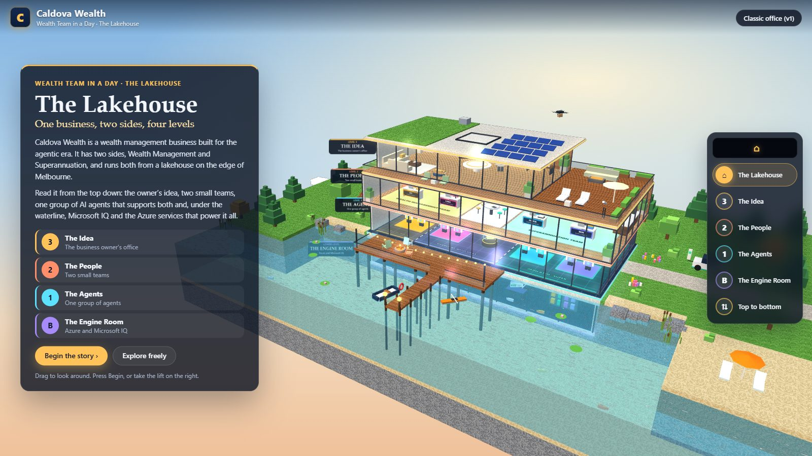
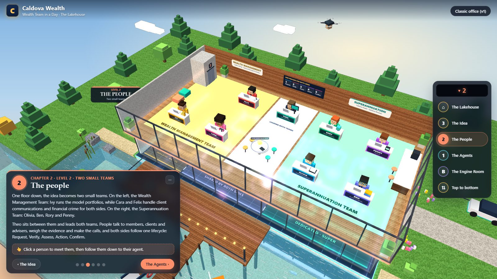

# Storybook — The Lakehouse (v2)

> Part of **Wealth Team in a Day** — the AI operations office demo for **Caldova Wealth**.

The v2 frontend, served at **`/v2`**, tells the Wealth Team in a Day story as a storybook. Caldova Wealth is a wealth management business built for the agentic era. It has **two sides**, Wealth Management and Superannuation, with a **small team for each side** and **one group of AI agents** that supports both. Viewers read the story from the top of a house to the bottom: the business owner's idea, the two teams, the agents, and the Microsoft IQ and Azure services underneath.

This document is the source of truth for v2: the setting, the cast, every page and how each page behaves. The page text in [`src/frontend/src/v2/storyData.ts`](../src/frontend/src/v2/storyData.ts) mirrors it, so change both together.



---

## The Big Idea

**One business, two sides, four levels, read from the top down.**

| Level | Name | Who or what is there | The question it answers |
|---|---|---|---|
| **3** | **The Idea** | Maya Ashworth, the business owner for both sides, and her idea: "the brain" | Why are we doing this, and what are the rules? |
| **2** | **The People** | Two small teams, one for each side, with Theo leading both | Who makes the decisions? |
| **1** | **The Agents** | One group of Microsoft Foundry agents: some dedicated to a side, some shared by both | Who does the reading, checking, calculating and drafting? |
| **B** | **The Engine Room** | Microsoft IQ and the Azure services, under the waterline | Where does the context come from, and what keeps it all running? |

Each level hangs off the one above it:

- The idea sets the goals and guardrails for both sides.
- People own the decisions, in two small teams.
- Each person's agent sits directly underneath them and reports back to them. The agents form one group: dedicated where the work is specialised, shared where it isn't.
- Microsoft IQ gives every agent the same context, and the Azure services power them all.

A thread runs through the whole house: **idea → person → agent → Microsoft IQ and Azure**. Whatever the viewer clicks, they can follow that thread up or down.

v1, the operations office and Melbourne neighbourhood at `/`, shows the request lifecycle across departments. v2 shows the same team **in depth**: what sits above the people and what sits underneath them. Both use the same cast, agents and five scenarios.

### The Two Sides

| Side | Products | Team | Dedicated agents |
|---|---|---|---|
| **Wealth Management** (gold `#c9a14a`) | Caldova Wrap · Caldova Managed Portfolios | Wealth Management Team: Ivy, Cara and Felix | Investment Analyst Agent |
| **Superannuation** (teal `#14b8a6`) | Caldova Super · Caldova Pension | Superannuation Team: Olivia, Ben, Rory and Penny | Onboarding, Benefits & Eligibility, Transfers & Rollovers, and Payments agents |
| **Shared by both** (lilac `#8b9cf7`) | Caldova Cash Account | Theo leads both teams | Financial Crime, Client Communications and Team Leader agents |

Cara and Felix sit with the Wealth Management Team (as in v1). Their work, communications and financial crime, spans both sides, so their agents are **shared**. The Super side has the most specialised processes (super law, rollovers and benefit payments), so it has the most dedicated agents. When a Super request needs an investment view, the Super team **calls in** the Wealth side's Investment Analyst.

---

## The Setting: A Futuristic Lakehouse

Caldova Wealth works from a casual, futuristic lakehouse on the edge of Melbourne. The whole scene is a floating voxel diorama, like the v1 office, with an island of grass, earth and stone layers and a lake carved into its front.

- **The house:** three storeys of timber, glass and white concrete, stacked with deep cantilevers.
  - The facade facing the lake and the right-hand side are glass.
  - The back walls are cedar slats, and the left wall holds a concrete lift core with a floor number lit above the lift doors on every level.
- **Two sides, left and right:** on every floor the Wealth Management side is on the left, the Superannuation side is on the right, and what both sides share is in the middle.
- **Edge lights:** each floor slab has a glowing edge strip in that level's accent colour: gold for the idea, coral for the people, cyan for the agents and violet for the engine room.
- **The roof:** a green roof, a skylight over the brain and a solar array.
- **Outside:**
  - A cedar deck on stilts over the water, with a fire pit, chairs and string lights.
  - A jetty with lanterns, a rowboat and a kayak.
  - Pines and autumn trees, and a sandy beach with an umbrella.
  - A gravel driveway with an EV at its charger, and a delivery drone circling the roof.
- **Under the waterline:** the engine room is sunk into the island behind a glass wall onto the lake, so fish swim past the servers.
- **Sky:** a golden-hour gradient. It dims to dusk when the story goes down to the engine room.

```
             ┌──────────── roof · green roof · skylight · solar ────────────┐
  LEVEL 3    │  THE IDEA    Maya's office · the brain (one half for each side) │  terrace
             ├───────────────────────────────────────────────────────────────┤
  LEVEL 2    │  WEALTH MANAGEMENT TEAM  │ Theo │  SUPERANNUATION TEAM         │
             │  Ivy · Cara · Felix      │ lead │  Olivia · Ben · Rory · Penny │
             ├───────────────────────────────────────────────────────────────┤
  LEVEL 1    │  DEDICATED · WEALTH │ SHARED BY BOTH SIDES │ DEDICATED · SUPER │ deck ═══ jetty
 ~~~~~~~~~~~~│~~~~~~~~~~~~~~~~~~~~~~~~~ waterline ~~~~~~~~~~~~~~~~~~~~~~~~~~~│~~~~~~~~~~~~
  LOWER      │  MICROSOFT IQ deck: Work IQ · Fabric IQ · Foundry IQ · Web IQ   │  lake
  LEVEL      │  Microsoft Foundry at the core · Azure services all around    │
             └───────────────────── glass wall onto the lake ────────────────┘
```

---

## The Cast

### Maya Ashworth — Managing Director, Caldova Wealth (Business Owner)

Maya is new in v2. She is the business owner for **both sides** of Caldova: Wealth Management and Superannuation. She sets the goals, decides where to invest, and holds the line on one rule: **people approve every decision that matters**. Like the staff, her name follows the role keyword: **M**aya, **M**anaging director. Her full profile is in [characters.md](characters.md#maya-ashworth--managing-director-business-owner).

- **Personality:** curious, practical and people-first.
- **Typical line:** "If a member has to chase us, we've already let them down."
- **Look:** smart-casual for the lakehouse: a cream knit, slate trousers, a Caldova-gold scarf, glasses and long dark hair.

**The idea** is the demo's product message, held in the brain above her table:

> Run both sides of Caldova with small expert teams supported by one group of AI agents: dedicated where the work is specialised, shared where it isn't, and all grounded in the same IQ layer on Azure. Requests become clearer, faster and more consistent, and people approve every decision that matters.

| Goal | What it means |
|---|---|
| **Clearer** | Members, clients and advisers always know where their request is and what happens next. |
| **Faster** | Agents do the reading, checking, calculating and drafting in minutes, so requests don't sit in a queue. |
| **More consistent** | Both sides follow one lifecycle, and every check cites the rule it relied on. |
| **People approve** | Agents recommend. A named person makes every decision that matters. |

**The guardrails** are the human approvals listed in the [README](../README.md#the-wealth-operations-agent-team):

- declines and partial approvals
- financial-crime blocks and SMRs
- payments of $250,000 or more, and every death benefit
- pension commencements of $1 million or more
- hardship releases
- complaint responses
- any communication to a fraud victim or a bereaved family

Agents never give personal financial advice.

### The People (Level 2)

The same eight staff as v1, at standing desks, arranged as two wings with Theo between them (see [characters.md](characters.md)):

- **Left wing, the Wealth Management Team** on a gold rug: Ivy (Investment Solutions), Cara (Client Communications) and Felix (Financial Crime).
- **In the middle,** Theo leads both teams from a desk on a lilac rug, with a huddle table in front where both teams meet.
- **Right wing, the Superannuation Team** on a teal rug: Olivia (Onboarding & Requests), Ben (Benefits & Eligibility), Rory (Transfers & Rollovers) and Penny (Payments).

### The Agents (Level 1)

Each person's **Microsoft Foundry agent** sits in a pod directly under their desk, with its two specialised assistants as small voxel robots. The assistants are named in `stepGate.ts` and [foundry_agents.md](foundry_agents.md). The floor is one group of agents in three zones, and each pod's frame glows in the colour of its side.

| Zone | Person | Foundry agent | What makes it different |
|---|---|---|---|
| Dedicated · Wealth | Ivy | `investment-analyst-agent` | MCP tools: analyse fact sheets, compare models, build the client workbook. The Super team calls it in for an investment view. |
| Shared by both | Cara | `client-communications-agent`, plus `client-communications-voice-agent` | Writes to super members and wealth clients alike, and has a voice agent on Azure Voice Live |
| Shared by both | Felix | `financial-crime-agent` | Azure Content Understanding checks documents for tampering, on both sides |
| Shared by both | Theo | `team-leader-agent` | Runs the group chat that coordinates the other seven agents on one case |
| Dedicated · Super | Olivia | `onboarding-agent` | Runs the NIGO checklist against the guides in Foundry IQ |
| Dedicated · Super | Ben | `benefits-eligibility-agent` | Cites a rule from Foundry IQ for every check |
| Dedicated · Super | Rory | `transfers-rollovers-agent` | MCP tools: look up funds, verify SMSFs, generate the transfer request PDF |
| Dedicated · Super | Penny | `payments-agent` | MCP tools for benefits and limits, then a Microsoft Teams approval |

All eight run on Microsoft Foundry and share the Microsoft IQ layer through the `CaldovaAgent` base class. At the front of the shared zone is the **Member Case**: the one record every agent reads from and writes to, wired to every pod.

### The Engine Room (Lower Level)

The engine room has two tiers. Each component is a voxel machine with a sign, wired to Microsoft Foundry by floor traces that carry pulses of data. The details come from `bicep/` and the backend code.

**Microsoft IQ, the context layer every agent shares**, stands on a raised deck behind Foundry, wired to the core by its own fuchsia traces. Microsoft IQ brings together Work IQ, Fabric IQ and Foundry IQ, plus Web IQ for the web. Each card says honestly what this demo runs today.

| Sign | Gives agents | In this demo |
|---|---|---|
| WORK IQ | How people work: the documents, conversations, meetings and past decisions in Microsoft 365, permission-trimmed | Not wired up. Adviser emails arrive as case documents, and approvals go to Microsoft Teams through an MCP tool. |
| FABRIC IQ | The state of the business: governed data, business entities, relationships and rules across both sides, built on Microsoft Fabric | Not wired up. The backend's Member Case store and the seeded case files stand in for it. |
| FOUNDRY IQ | Policies and documents: the PDS and trust-deed extracts, super rules, fee schedule, model portfolio menu and case files, returned with citations | Live. Azure AI Search is now Foundry IQ, and every agent grounds on and cites the `wealth_knowledge` index (semantic search enabled). |
| WEB IQ | The web, right now: timely, citation-ready context from the public web | Stood in for by the Grounding with Bing Search connection in the Foundry project. |

**The Azure services** fill the rest of the room. Along the glass are the ones particular agents call, and behind the bus is the platform.

| Sign | Component | What it does | Used by |
|---|---|---|---|
| MICROSOFT FOUNDRY | Agent platform and model | Hosts the nine agents and the `gpt-5.4` deployment (GlobalStandard, default content filters) | Every agent |
| MCP TOOLS | `caldova-ops-mcp` at `/mcp` | Tools that let agents act on systems | Ivy (Wealth), Rory and Penny (Super) |
| TEAMS APPROVALS | Microsoft Teams adaptive cards | A payment waits for a human approval (sent by `teams_sendApprovalCard`; delivery is simulated in the demo) | Penny, approved by Theo |
| CONTENT UNDERSTANDING | Azure Content Understanding | Legit, suspicious or fake verdicts on documents | Felix (shared) |
| VOICE LIVE | Azure Voice Live | Talk to Cara's voice agent; the backend proxies the WebSocket | Cara (shared) |
| ENTRA ID | Managed identities and RBAC | No keys in code; roles scope each identity. Its gate stands beside the lift. | Platform |
| NETWORK | How it all connects | HTTPS everywhere plus a WebSocket for Voice Live, over public endpoints secured by Entra ID; production would add private endpoints | Platform |
| KEY VAULT | Azure Key Vault | Provisioned for secrets and keys | Platform |
| STORAGE | StorageV2 account | Provisioned for documents and generated files | Platform |
| APP SERVICE | Two Linux web apps | The frontend (Node 20) and the backend (.NET 10: agent console, APIs, Member Case store, MCP endpoint) | Platform |
| APP INSIGHTS | Application Insights and Log Analytics | Telemetry from both web apps | Platform |

---

## How to Read the Storybook

The storybook has a cover, four chapters (one per level) and a finale. Each chapter opens up its level: the levels above lift away and fade out, so the camera can look straight in.

| Control | What it does |
|---|---|
| **Begin the story ›** on the cover | Opens Chapter 1 |
| **Next › / ‹ Back**, the page dots, or the **arrow keys** | Turn the page; down and right go deeper |
| **The lift** on the right (⌂, 3, 2, 1, B, ⇅) | Jumps to any level; the display shows the floor and the direction of travel |
| **Click** a person, the brain, an agent pod or a machine | Opens its card, lights it up and draws its thread through the house |
| **Card actions** such as "Follow Cara down to the agent ↓" | Move along the thread to the level below or above |
| **Esc**, or clicking empty space | Closes the card |
| **–** on the page card | Hides the storybook so the viewer can explore freely; **📖 Open the storybook** brings it back |
| **Drag / scroll** | Orbit and zoom at any time |
| **Home / End** | Cover / finale |

Every page has a deep link, for example `/v2/?page=people`. The address bar updates as the viewer turns pages.

---

## The Pages

### Cover — One Business, Two Sides, Four Levels


- **Scene:** The whole lakehouse at golden hour, with the camera slowly circling until the viewer touches it. The level tags float beside the house, and the gold and teal wings show through the glass.
- **Narration:** "Caldova Wealth is a wealth management business built for the agentic era. It has two sides, Wealth Management and Superannuation, and runs both from a lakehouse on the edge of Melbourne. Read it from the top down: the owner's idea, two small teams, one group of AI agents that supports both and, under the waterline, Microsoft IQ and the Azure services that power it all."
- **Interaction:** "Begin the story ›" or "Explore freely". The cover lists the four levels with their colours.

### Chapter 1 — Level 3 · The Idea


- **Scene:** The roof lifts off Maya's office.
  - Maya stands by a round white table. Above it floats a voxel brain with **one hemisphere for each side**: gold for Wealth Management and teal for Superannuation, joined by a lilac bridge for what they share. Four goal tiles orbit it: CLEARER, FASTER, CONSISTENT, PEOPLE APPROVE.
  - On the back wall is a vision board: "The idea · a wealth business for the agentic era · Wealth Team in a Day", with three panels (Wealth Management, One group of agents, Superannuation) and "Grounded in Microsoft IQ on Azure · agents recommend, people approve". There is also a bookshelf, and Maya's desk has a North Star dashboard.
  - In the lounge corner are a sofa and a floor lamp, and Biscuit the office dog is asleep on her bed.
  - Outside are the balcony and a terrace with loungers, an umbrella, a fire table and a telescope pointed at the lake.
- **Narration:** "This is Maya Ashworth's office. Maya is Caldova's managing director and the business owner for both sides: Wealth Management (Caldova Wrap and the managed portfolios) and Superannuation (Caldova Super and Caldova Pension). Her idea for the agentic era: run each side with a small expert team, supported by one group of AI agents that are dedicated where the work is specialised and shared where it isn't. People still approve every decision that matters. The brain above her table holds the idea, one half for each side."
- **Interaction:**
  - **The brain:** its card shows the idea, the two sides with their products and teams, the one group of agents, the four goals, the lifecycle and the guardrails. Gold threads drop from the brain to every person on Level 2.
  - **Maya:** her profile card, including her two sides.
- **Intro beat:** the brain lights up and spins faster.

### Chapter 2 — Level 2 · The People



- **Scene:** Level 3 lifts away to reveal the open-plan team floor, split into two wings.
  - **Left wing:** the Wealth Management Team on a gold rug, under a WEALTH MANAGEMENT sign (Caldova Wrap · Caldova Managed Portfolios).
  - **Right wing:** the Superannuation Team on a teal rug, under a SUPERANNUATION sign (Caldova Super · Caldova Pension).
  - **In the middle:** Theo ("leading both teams") on a lilac rug, below the ONE PROCESS FOR BOTH SIDES board. In front of him is the huddle table, with gold stools on the wealth side and teal stools on the super side ("both teams meet here").
  - Every standing desk has a name panel in the department colour and a prop that says something about the role: Ivy's bar chart, Cara's headset, Felix's magnifier, Theo's dashboard, Olivia's inbox tray, Ben's rule books, Rory's globe and Penny's calculator.
  - There is a coffee bar on the right and beanbags by the lift. Theo walks to the huddle table, looks over each wing in turn, and goes back to his desk.
- **Narration:** "One floor down, the idea becomes two small teams. On the left, the Wealth Management Team: Ivy runs the model portfolios, while Cara and Felix handle client communications and financial crime for both sides. On the right, the Superannuation Team: Olivia, Ben, Rory and Penny. Theo sits between them and leads both teams. People talk to members, clients and advisers, weigh the evidence and make the calls, and both sides follow one lifecycle: Request, Verify, Assess, Action, Confirm."
- **Interaction:** Click a person to open their card. It shows:
  - their role, team, responsibilities and typical line
  - their agent one floor down, and whether that agent is dedicated to a side or shared by both

  "Follow {name} down to the agent ↓" opens Chapter 3 with that agent selected. "Open the agent page ↗" opens the backend's `/agents/{id}` walkthrough.
- **Intro beat:** "The idea drops in": gold sparks fall from where the brain sits above and land on each desk, and each person lights up as their spark arrives.


### Chapter 3 — Level 1 · The Agents


- **Scene:** Level 2 lifts away to reveal a dark glass floor with a glowing grid, split into three tinted zones by dashed lines and lettered at the front: DEDICATED · WEALTH (gold), SHARED BY BOTH SIDES (lilac) and DEDICATED · SUPER (teal).
  - Under every desk is a coloured pod with that person's two assistants (voxel robots). The pod's frame glows in its side's colour.
  - Each pod has a holo panel showing the agent's name, its side, its Foundry agent id, and "2 assistants · works for {name}".
  - The **Member Case** hub glows at the front of the shared zone, wired to every pod by circuit traces that carry data packets out and back.
  - Theo's pod has a floating **group chat** ring, and Cara's has a **voice agent** equaliser.
  - The back wall by the lift reads "ONE GROUP OF AGENTS · Dedicated to one side, or shared by both".
- **Narration:** "Under the desks is one group of Microsoft Foundry agents that supports both teams. Each person has an agent with two specialised assistants, and Cara also has a voice agent. Some agents are dedicated to one side: four on the Super side, and the Investment Analyst on the Wealth side. Financial Crime, Client Communications and the Team Leader agent are shared by both. They all work on one Member Case, and a person always decides."
- **Interaction:** Click a pod to open its card. It shows:
  - its side and why it is dedicated or shared
  - the Foundry agent id and both assistants
  - what makes it different, and what it runs on in the engine room

  The pod's ring lights and threads drop to those components. "Back up to {name} ↑" or "What powers it ↓".
- **Intro beat:** the pods power up one after another.

### Chapter 4 — Lower Level · The Engine Room


- **Scene:** Level 1 lifts away and the deck fades, revealing the engine room sunk into the island. The sky turns to dusk.
  - **Microsoft Foundry** sits in the middle as a glowing core with orbiting rings, and a beam rises from it to the agents above.
  - **The Microsoft IQ deck** is behind the core: a raised violet platform with a glowing fuchsia edge and a MICROSOFT IQ sign ("the context layer every agent shares"). It holds:
    - **Work IQ:** floating document, chat and meeting tiles with signals orbiting them.
    - **Fabric IQ:** a rotating lattice of business entities and their relationships in a glass case.
    - **Foundry IQ:** shelves of indexed documents with a scanning beam.
    - **Web IQ:** a voxel globe with an antenna.
  - **Along the glass:** the Content Understanding scanner, the Voice Live studio mic, the Teams approvals console with its floating approval card, and the MCP tool rack.
  - **Behind the bus:** the Entra ID gate with its floating key (beside the lift), the network patch panel with blinking ports, the Key Vault door, the storage crates, the App Service racks (FRONTEND, BACKEND) and the App Insights screens.
  - An AZURE SERVICES sign ("the platform underneath") is on the left wall, and the glass wall at the front looks onto the lake.
- **Narration:** "Below the waterline is the platform. Microsoft Foundry is the core: it runs every agent on the gpt-5.4 model. On the raised deck behind it is Microsoft IQ, the context layer every agent shares: Work IQ, Fabric IQ, Foundry IQ and Web IQ. Around them are the Azure services. Along the glass are the ones particular agents call: MCP tools, Teams approvals, Content Understanding and Voice Live. Behind, Entra ID, Key Vault, Storage, App Service and Application Insights keep it all secure, hosted and observable over HTTPS."
- **Interaction:** Click a component to open its card. It shows:
  - its tier (Microsoft IQ or Azure services) and what it is
  - for the IQ components, what this demo runs today
  - the technical details, and how it is secured and connected
  - which agents use it, with each agent's side

  "Back up to the agents ↑" opens Chapter 3 with those agents ringed.
- **Intro beat:** the traces light up outward from Foundry.

### Finale — One Request, Top to Bottom


- **Scene:** The house pulls apart into an exploded view, with all four levels stacked with gaps between them. Threads show the whole house as one tree: gold from the brain to every person, coral from each person to their agent, violet from each agent to Microsoft Foundry.
- **Narration:** "Now watch a real member request travel through the house. Each step starts with a person, dips down to their agent and the engine room, and comes back up for a human decision. These are Super requests: they use the Super side's agents and the shared ones, and call in the Wealth side's Investment Analyst when they need an investment view. The result rises to Maya's floor."
- **The trace:** a glowing orb carries one member's request through the house. The steps come from the v1 scenario beats in `src/frontend/src/scenarios/*.json`, so both versions tell the same five stories. All five are Superannuation member requests.
  1. **Arrival:** the request flies in over the lake to Olivia's desk.
  2. **Each step:** the orb stops at the person (Level 2), drops to their agent (Level 1), and dips to the engine-room component that agent leans on. It then comes back up to the person, who decides. A handover is just a short stop.
  3. **Result:** the orb rises to the brain on Level 3 with the outcome.
- **Panel:**
  - the member chips: Priya, Grace, George, Tom and Robert (George by default)
  - the current step, with a chip for its side, for example "Step 3 of 9 · Ben · Benefits & Eligibility · DEDICATED · SUPER · Ben → Benefits & Eligibility Agent → Foundry IQ · wealth_knowledge"
  - the narration, and **Pause**, **Next step** and **x1/x2/x4** controls

  The chip reads "Superannuation request" on arrival, "Dedicated · Super" or "Shared · both sides" for each step, and "Dedicated · Wealth · called in" when Ivy's agent joins a Super request.
- **Interaction:** Pick a member to replay their request. "Back to the cover ↺" starts the storybook again.

---

## Following a Thread

Every card ends with actions that move along the same thread, so viewers can trace any part of the house to the rest of it.

| Click | Lights up | Threads drawn | Card actions |
|---|---|---|---|
| Maya | Maya and the brain | — | See her idea · Meet the team ↓ |
| The brain | The brain | Brain → every person | Meet the team ↓ · Meet Maya |
| A person | The person, their pod, and their engine-room dependencies | Person → agent → components | Follow them down ↓ · Open the agent page ↗ |
| An agent pod | The pod, its person, and its dependencies | Person → agent → components | Back up ↑ · What powers it ↓ · Open the agent page ↗ |
| A component | The component and every agent that uses it | Component → agents → people | Back up to the agents ↑ |

Only the level being read is clickable, so a click never lands on something hidden under a floor.

---

## Visual Direction

- Voxel and isometric, like v1: a miniature diorama with a high three-quarter camera.
- **Casual and futuristic:** warm timber, glass and white concrete, glowing edge strips, holograms, a drone and an EV charger. It should never feel like a data centre brochure.
- **One accent per level:** Idea `#ffc35a` (gold) · People `#ff8f6b` (coral) · Agents `#5ce1ff` (cyan) · Engine Room `#a78bfa` (violet).
- **One colour per side**, used for rugs, signs, zones, pod frames and badges: Wealth Management `#c9a14a` (gold) · Superannuation `#14b8a6` (teal) · Shared by both `#8b9cf7` (lilac). These match the v1 team colours. Department colours stay as in v1.
- **Two tiers underground:** Microsoft IQ `#e879f9` (fuchsia) on the raised deck, and Azure services `#60a5fa` (blue) around it.
- **Readable at a glance:** every desk, pod and machine carries a sign, and each card says what the thing is in plain English before any technical detail.
- **Avoid:** real company logos, readable personal or financial details, anything suggesting agents decide on their own, and claiming the demo uses an IQ component it doesn't.

---

## Keeping v2 in Sync

| What | Where |
|---|---|
| Page text, camera shots and stack modes | `src/frontend/src/v2/storyData.ts` (mirrors this document) |
| The two sides, Maya, the idea, each agent's side, the IQ tier and Azure services | `src/frontend/src/v2/lakehouseData.ts` |
| Desk positions, wings (Level 2) and zones (Level 1) | `src/frontend/src/v2/layout.ts` |
| Staff, teams, assistants and clients | Shared with v1: `personaData.ts`, `stepGate.ts`, `characterPalettes.ts` |
| The finale's steps | Shared with v1: `scenarios/*.json` |
| Levels and the house | `src/frontend/src/v2/levels/*.ts`, `shell.ts`, `exterior.ts` |

**To run it locally**, start the frontend with `npm run dev` in `src/frontend`, then open <http://localhost:5173/v2/>.

**In production**, App Service serves the build with `pm2 serve --spa`, which answers `/v2` with the v1 `index.html`. A one-line guard at the top of that file forwards `/v2` and `/v2/` to `/v2/index.html`, keeping any `?page=` deep link.
